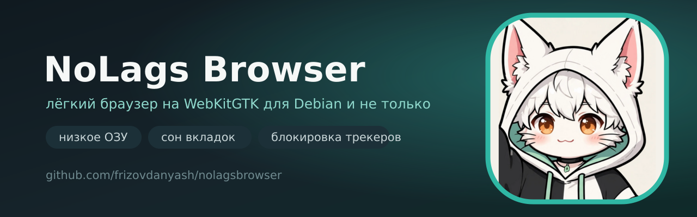

<p align="center">
  
</p>

<h1 align="center">NoLags Browser</h1>

<p align="center">
  Лёгкий браузер для слабых компьютеров: низкое потребление ОЗУ, сон вкладок и минимум интерфейса.
</p>

<p align="center">
  <a href="https://github.com/frizovdanyash/nolagsbrowser/releases/latest">Скачать</a> ·
  <a href="#возможности">Возможности</a> ·
  <a href="#установка">Установка</a> ·
  <a href="#горячие-клавиши">Клавиши</a> ·
  <a href="#сборка">Сборка</a>
</p>

<p align="center">
  
  
  
  
  
</p>

---

## Что это

NoLags Browser — компактный браузер, который не пытается заменить Chrome, а честно экономит память на машинах вроде
Pentium G620 / 4 ГБ ОЗУ. Движок — WebKitGTK (Debian 13), интерфейс — GTK 3, всё остальное написано на Python.
Данные (история, закладки, загрузки, заметки, сеанс) лежат в обычном SQLite-файле.

| | |
|---|---|
| **Debian 13** | `.deb`-пакет, движок WebKitGTK 2.4x, GTK 3 |
| **Windows** | `.exe` на WebView2 (Chromium), тот же набор функций |
| **Память** | сон неактивных вкладок, ручная очистка, режим низкого потребления |
| **Приватность** | блокировка трекеров, ITP, запрет сторонних cookie, hosts-генератор |

<p align="center">
  
</p>

## Возможности

**Вкладки и навигация**

- вкладки сверху, снизу или в боковой панели, перетаскивание, закрепление
- сон вкладок: неактивная вкладка выгружается и освобождает память, при возврате загружается заново
- восстановление закрытых вкладок и всего сеанса после перезапуска
- поиск по открытым вкладкам, список вкладок, переключение `Alt+1…9`
- адресная строка с подсказками из истории, закладок и поисковиков
- приватное окно с отдельным контекстом без истории

**Память**

- ручная кнопка «Освободить память» (`malloc_trim` + очистка кэша WebKit)
- автосон вкладок по таймеру (по умолчанию 10 минут)
- режим низкого потребления: кэш документа вместо кэша браузера, отключение предзагрузки и DNS-prefetch
- диспетчер вкладок с потреблением памяти и кнопкой «Усыпить»
- выключение WebGL, изображений, плавной прокрутки и аппаратного рендеринга для самых слабых машин

**Приватность и блокировка**

- список трекеров из коробки (рекламные и аналитические домены)
- загрузка полного hosts-списка StevenBlack одной кнопкой (77 000+ доменов)
- генератор `hosts`-файла для системной блокировки
- ITP (Intelligent Tracking Prevention) и запрет сторонних cookie
- очистка истории, cookie, кэша, заметок и списка загрузок

**Страницы и данные**

- стартовая страница с маскотом, частыми сайтами и живым индикатором памяти
- история по дням с поиском и экспортом в JSON
- закладки с папками, импорт и экспорт HTML (совместимо с Firefox/Chrome) и JSON
- менеджер загрузок, заметки к страницам, горячие клавиши отдельной страницей
- режим чтения, тёмная/сепия/чёрно-белая тема страниц
- поиск по странице, масштаб, полный экран, печать, сохранение страницы в MHTML, скриншот всей страницы
- инструменты разработчика и просмотр исходного кода
- смена User-Agent (Chrome, Firefox, мобильный), свой поисковик, своя тема

**Сбор данных для теста**

| Профиль | Браузер | Потребление ОЗУ |
|---|---|---|
| NoLags, 1 вкладка (стартовая) | WebKitGTK | ~180–220 МБ (все процессы) |
| NoLags, 8 вкладок, 5 усыплено | WebKitGTK | ~250–300 МБ |

Цифры — с `Pss` всех процессов WebKit на Debian 13; ваш профиль зависит от сайтов и шрифтов.

## Установка

### Debian 13 / Ubuntu 24.04+

```bash
sudo apt install ./nolagsbrowser_1.0.0_all.deb
nolagsbrowser
```

Пакет ставит:

| Путь | Содержимое |
|---|---|
| `/usr/bin/nolagsbrowser` | запуск |
| `/usr/share/nolagsbrowser/` | код, маскот, иконки |
| `/usr/share/applications/nolagsbrowser.desktop` | меню приложений |
| `/usr/share/icons/hicolor/*/apps/nolagsbrowser.png` | иконки 16–512 px |
| `/usr/share/man/man1/nolagsbrowser.1` | man-страница |

Зависимости: `python3-gi`, `python3-gi-cairo`, `gir1.2-gtk-3.0`, `gir1.2-webkit2-4.1`.

### Windows 10/11

1. Скачайте `nolagsbrowser-1.0.0-setup.exe` (установщик) или `NoLagsBrowser.exe` (портативный).
2. Нужен [Microsoft Edge WebView2 Runtime](https://go.microsoft.com/fwlink/p/?LinkId=2124703) — на Windows 10/11 он обычно уже установлен.

### Из исходников

```bash
sudo apt install python3-gi python3-gi-cairo gir1.2-gtk-3.0 gir1.2-webkit2-4.1
git clone https://github.com/frizovdanyash/nolagsbrowser
cd nolagsbrowser
PYTHONPATH=src python3 -m nolags
```

## Горячие клавиши

| Клавиши | Действие |
|---|---|
| `Ctrl+T` / `Ctrl+W` | новая / закрыть вкладку |
| `Ctrl+Shift+T` | вернуть закрытую вкладку |
| `Ctrl+L`, `Alt+D`, `F6` | адресная строка |
| `Ctrl+F`, `Ctrl+G`, `F3` | поиск по странице и следующее совпадение |
| `Alt+←` / `Alt+→` | назад / вперёд |
| `Ctrl+R`, `Ctrl+Shift+R` | обновить, обновить без кэша |
| `Ctrl+D`, `Ctrl+Shift+D` | в закладки, все вкладки в закладки |
| `Ctrl+H`, `Ctrl+J` | история, загрузки |
| `Ctrl+B` | панель закладок |
| `Ctrl+Shift+Delete` | очистка данных |
| `Ctrl+U`, `F12` | исходный код, инструменты разработчика |
| `Ctrl+P`, `Ctrl+S`, `Ctrl+Shift+S` | печать, сохранить страницу, скриншот |
| `Ctrl+=`, `Ctrl+-`, `Ctrl+0` | масштаб страницы |
| `Ctrl+Shift+M` | звук вкладки |
| `Ctrl+Shift+F` | режим чтения |
| `F11` | полный экран |
| `Ctrl+Shift+P` | командная строка |
| `Ctrl+Shift+N` | приватное окно |

## Где лежат данные

| ОС | Путь |
|---|---|
| Linux | `~/.config/nolagsbrowser/settings.json`, `~/.local/share/nolagsbrowser/profile.db`, `~/.cache/nolagsbrowser` |
| Windows | `%APPDATA%\NoLagsBrowser\` |

Кэш и cookie можно удалить в любой момент: `Ctrl+Shift+Delete` или «Настройки → Данные».

## Сборка

### `.deb`

```bash
bash scripts/build-deb.sh
# результат: dist/nolagsbrowser_1.0.0_all.deb
```

### Windows `.exe`

```bash
cd windows/NoLagsBrowser
dotnet publish -c Release -r win-x64 --self-contained true \
  -p:PublishSingleFile=true -p:IncludeNativeLibrariesForSelfExtract=true \
  -p:EnableCompressionInSingleFile=true -o out
# установщик: makensis windows/installer.nsi
```

### Обновить блок-лист в репозитории

```bash
BLOCKLIST_OUT=data/blocklist.txt scripts/update-blocklist.sh
```

## Структура

```
src/nolags/          движок браузера на GTK3 + WebKitGTK
  app.py             приложение, контексты WebKit, темы
  window.py          окно, вкладки, команды
  widgets.py         адресная строка, вкладки, меню, панель поиска
  pages.py           стартовая страница, история, закладки, заметки, о браузере
  storage.py         SQLite-профиль
  adblock.py         списки доменов и css-фильтры
  settings.py        настройки
  settings_ui.py     окно настроек
  mascot.py          маскот и лапка
  dialogs.py         очистка данных, диспетчер вкладок, командная строка
windows/NoLagsBrowser/  версия для Windows на WebView2
  MainForm.cs        окно, вкладки, меню, сон вкладок
  StartPage.cs       стартовая страница
  Storage.cs         профиль в JSON
  SettingsForm.cs    настройки
data/                desktop-файл, man, иконки
assets/              маскот и брендинг
scripts/             сборка пакета, блок-лист, ассеты
```

## Лицензия

MIT. Маскот — белый кот в чёрно-белых чулках, нарисован для проекта.
